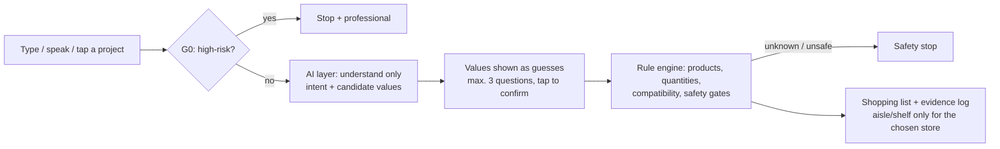

# Baumarkt-Buddy 🛠️
*Rule-checked shopping assistant for DIY stores – MBA Applied AI group project (vibe coding)*

## What is it?
Baumarkt-Buddy is a mobile web app for DIY-store customers. The customer describes
a home project – **by typing, by voice or with a project button** – answers at most
three short questions and gets a **checked shopping list**: materials, tools and
safety gear with quantity, price, stock and aisle/shelf in the chosen store.

**Safety comes before convenience: when in doubt, the app stops instead of guessing.**
Dangerous work (electrics, gas, load-bearing walls, hidden pipes and cables) is
refused with a referral to a professional.

**Release 1 (MVP)** supports the 9 projects of the team's project catalogue
(`data/project_catalogue.xlsx`, draft v1) with sample data:

| Group | Projects | Safety level |
|---|---|---|
| Wall mounting | Hang a shelf · Hang a wall cabinet · Anchor a shelf (anti-tip) | Mounting – full |
| Wall mounting | Hang a picture | Mounting – light |
| Decorating | Paint a wall · Hang nonwoven wallpaper | Basic |
| Doors & locks | Install a glass door · Install a sliding door | Mounting – full |
| Doors & locks | Change the lock of an interior door | Basic |

*Basic* projects ask no wall or load questions; the high-risk filter, catalogue
check, product warnings and stop rules always run. Photo entry, saved projects,
offline mode, store maps and step-by-step guides are planned for later releases
([R2–R4 requirements](requirements/requirements-R2-R4.md)).

👉 **Live app:** `https://st854d2gpb-create.github.io/9_Applied-AI/` (after GitHub Pages is enabled, see below)

## Why this idea?
Real customer problem, our own sample data, low GDPR risk, buildable in 2 weeks,
and a clear B2B customer (the DIY store).

## How it works


| Layer | File | Responsibility |
|---|---|---|
| Input | `app/app.js` | Free text, voice and project buttons. Typed and dictated text use the same path (`submitText`) – no special path for speech |
| Voice input | `app/speech.js` | Browser Web Speech API → editable transcript; never records, stores or sends audio itself |
| AI (understanding only) | `app/ai-adapter.js` | Classifies the intent and extracts candidate values as schema-validated JSON. **Never chooses products or decides safety** |
| AI proxy (optional) | `proxy/` | Cloudflare Worker that keeps the API key server-side and rate-limits |
| Rule engine (all decisions) | `app/rules.js` | Fact gate, product choice, quantities, compatibility, load limits, notices, evidence log, PLZ check and store search |
| Data | `app/data.js`, `app/data/` | Loads the Excel file (SheetJS), templates, word lists and the PLZ table – data files, not code |
| Texts | `app/i18n.js` | All UI texts in English (default) and German |
| Config | `app/config.js` | Data paths, AI mode, store distance and number of stores shown |

### Safety rules in code
- **Fact status (SR-01, SR-11):** every value is a *guess* (`observed`, from text or speech), *confirmed by you* (`user-confirmed`, tapped) or *manufacturer data*. Only the last two drive decisions.
- **Mounting gate (SR-03):** no wall plugs and no final mounting list until wall type **and** load are confirmed.
- **No certification (SR-02):** the app never says a wall can hold a load or is safe to drill. Every list that goes into the wall shows the **detector-limits notice** – detectors often miss plastic pipes; "nothing found" is no clearance (SR-05).
- **No adding up (SR-04):** every load-bearing part (board, bracket, plug, screw) must carry the whole load × 1.25 on its own; above 50 kg, or above 25 kg on plasterboard, the app stops.
- **Fail-safe (SR-06):** unknown, missing or contradictory data → stop with an explanation of what to check.
- **Manufacturer wins (SR-07):** the product's `safety_note` is shown unchanged; generated text that could weaken it is dropped.
- **Re-check (SR-08):** changing wall type, load, size or a product variant re-runs all checks.
- **Scope (SR-09):** high-risk work is refused before the AI is asked – the same for typed and spoken text.
- **Variants:** a look-alike but wrong screw, plug or drill bit is flagged as "does not fit"; an unclear pack size gives no total.
- **Store data:** stock and aisle/shelf only from the selected store – never invented, never from another store.

## Look and feel
DIY-store app style: white page, orange header band (**#FF7313**) with a diagonal
edge and the title in a white box, a round language button, condensed bold
headlines, black pill buttons and outlined secondary buttons, outlined project
tiles with line icons, flat product rows with big prices and an availability dot,
the total in a black price box, and a bottom tab bar (Start · Store · List).
Only general style cues – no logo, mascot, name or other brand assets of a real
company. Colour tokens are at the top of `app/style.css`. White text on #FF7313
would fail WCAG contrast (2.7:1), so text on orange is black and orange text uses
darker shades (#E05A00 for large bold text, #C85000 for normal text).

## Using the app
A **progress bar** under the header shows where the customer is: **Store → Project →
Questions → List → Shopping** (done steps orange, current step bold). A safety stop turns the step
where it happened red (e.g. "unknown wall" at Questions, high-risk work at Project).
It is hidden on the start notice.

1. **Start:** notice about AI use, sample data, privacy and the browser speech service.
2. **Store (optional):** enter a postcode → sample stores within 50 km, nearest first → tap one. Or skip.
3. **Project:** describe it (type or 🎤) or tap one of the 9 project buttons (grouped, with safety level).
4. **Check:** "Did we understand you correctly?" – recognised values are guesses.
5. **Questions (max. 3 screens):** e.g. wall type, weight, sizes, condition checklists (mould, used-item defects) – guesses are pre-filled, you confirm by tapping. Stop rules from the catalogue (ST-01…ST-14) end the flow with a hand-off to staff or a specialist.
   **Weight (D-2, FR-04, SR-14):** "I know it", "Weigh it" (bathroom-scale tip), "Estimate for me" (shelf only: 1 kg per 4 cm of shelf for books, rule SHELF-E1 – shown as estimate, counts only after "Confirm") or "I don't know". *I don't know* plans for the project's worst case = its highest allowed load (shelf 50 kg, cabinet 50 kg, picture 25 kg, sliding door 60 kg; team decision 31 Oct 2026). If that worst case is above the wall's limit or no part can carry it, the app stops with ST-05 "please weigh it or ask OBI staff".
6. **List:** mark parts you **already have** ("I already have this" – the item stays visible, marked, and is not counted; never for plugs and screws; a used load-bearing part with a reported defect stays on the list; own tools and safety gear get the hint "Keep the right tool and gear to ensure safety.", SR-17). Each section shows its **subtotal**; the total is the sum of the subtotals (FR-34). There is no tick box any more (D-3). Change a variant, your answers or the store, open the OBI how-to links (projects 5–9). "Why these products?" opens the evidence log.
7. **Save list (FR-17, DR-06):** "Save list" downloads a text file with products, quantities, prices, section subtotals and total, items you already have, aisle/shelf/stock of the chosen store, product warnings, safety notes and how-to links. It is built on the device – nothing is sent, your postcode is not in the file. Where the browser supports it, "Share list" opens the phone's share sheet with the same file.
8. **Shopping by aisle:** the orange button "Start shopping by aisle" under the list opens the same checked list sorted for the walk through the chosen store – grouped by aisle (ascending, numbered), within an aisle by shelf, with packs per item. Items you already have are left out; items the store cannot supply are listed under "Not on the route in this store" with the nearest store that has them or "please ask staff" (FR-31). Safety notices stay visible. Without a store the app asks for a postcode first. It only reorders the list – no tick boxes (D-3), no new decision.

## AI adapter modes (`aiMode` in `app/config.js`)
| Mode | What it does | Cost |
|---|---|---|
| `template` **(default – team decision)** | Keyword matching with `data/understanding-lexicon.json`: intents, wall types, units and number words in DE/EN ("zwölf Kilo", "twelve kilos", "80x25 cm"). Tolerates spelling mistakes and word forms ("Regla", "Regall", "Bücherregla", "shefl" → shelf) – always only a guess the customer confirms | free |
| `proxy` | A commercial language model via `proxy/` – built, **not active**. Set `ai.proxyUrl` | API usage |
| `mock` | Fixed answers from `data/ai-mock-responses.json` for tests and demos; also via `app/index.html?ai=mock` | free |

**Spelling mistakes (template mode):** exact keywords are tried first; if none
matches, word forms and compounds ("Regale", "Eckregal") and words with one typo
("Regla", swapped letters count as one mistake; two from 9 letters) are accepted.
Only keywords with 5+ letters and the same first letter count, so short words like
"Bild" need the exact spelling. Real words that only look like a typo ("Frage" is
not "frame") are listed in `typo_exceptions` in the lexicon. If two projects could
be meant, the app shows the project buttons. Phrases are matched word by word
with one mistake per word ("stud wlal", "tragende Wnad"; 4-letter words only with
two swapped letters). The "Did we understand you correctly?" screen lists every
correction – e.g. *"regla" read as "Regal"* – so the customer can spot a wrong
guess (NFR-05). The high-risk check (SR-09) uses the same tolerance – "Steckdoze"
and "tragende Wnad" are refused like the correct spelling.

All modes return the same JSON (`intent`, `high_risk`, `facts`), which is validated
in code; anything unexpected is discarded. If the AI fails, times out or answers
invalidly, the app offers the project buttons and keeps the text and the values
already recognised (NFR-03). Before text goes to the proxy, postcodes, phone numbers
and e-mail addresses are removed; only `text` and `lang` are sent (NFR-04).

## Voice input (FR-25, FR-27, SR-11)
First tap on 🎤 → in-app notice about the browser's speech service → "Allow
microphone" → the browser asks for permission → red recording indicator (stop by
tap or Esc) → live transcript in the text field → the customer checks or edits it
and taps **Continue**. Only then is the text processed. Spoken values are guesses
and are read back in the questions. Language follows the UI (`en-US` / `de-DE`).

| Browser | Voice input | Speech service (may receive the audio) |
|---|---|---|
| Chrome (desktop, Android) | yes | Google |
| Edge | yes | Microsoft |
| Safari (macOS, iOS) | yes (Siri/dictation must be enabled) | Apple |
| Firefox | **no** – hint shown; typing and buttons work | – |
| Other browsers on iOS | depends on the browser | Apple |

Needs HTTPS or `localhost`. Denied, missing or failing microphones show a hint;
typing and the project buttons always work.

**Manual check with real speech** (automated tests use a simulated speech API):
| # | Language | Say | Expected |
|---|---|---|---|
| S1 | EN | "I want to hang a shelf, twelve kilos, concrete wall, eighty centimetres long" | Shelf; 12 kg, concrete, 80 cm as guesses |
| S2 | DE | "Ich möchte ein Regal für zwölf Kilo an eine Betonwand hängen, 80 Zentimeter lang" | Regal; 12 kg, Beton, 80 cm als Vermutung |
| S3 | DE | "Zwei Bilder mit je drei Kilo an die Ziegelwand" | Bild; 3 kg, Ziegel, 2 Bilder |
| S4 | DE | "Ich will eine Steckdose versetzen" | Stop screen "needs a professional" |
| S5 | any | Deny the microphone in the browser prompt | Hint; typing and buttons work |

## Store selection by PLZ (FR-29, FR-30)
- The PLZ is checked in code: exactly 5 digits **and** present in the PLZ table.
- Valid → stores within `store.maxDistanceKm` (50 km), sorted by straight-line distance, at most `store.maxStoresShown` (5), with address and opening hours.
- Invalid, unknown or no store in range → message plus the full store list.
- **A store is never selected automatically** – not even the nearest one or the only one in range; the customer taps it (RB-16, SR-06). *Team decision 25 Oct 2026: no preselection* – FR-29, design D-11 and TC-38 say the same.
- Skipped → the complete list with identical checks; aisle, shelf and stock show "not available" plus an "Add postcode" button.
- The PLZ stays on the device: never sent to the AI, never logged, cleared after the choice. Only the PLZ centre coordinates are kept in memory for referral distances (FR-31).
- If the PLZ table or store data fail to load, the app continues without a store.

## Availability in the chosen store (FR-31, RB-21)
- In the data, an **empty aisle** means the store does not carry the product; **qty 0** means it is out of stock.
- Such an item **always stays on the list**, marked "Not available in <store> (out of stock / not carried)". Quantities, checks and the total do not change.
- The app names the **nearest other sample store with qty > 0** within 50 km, measured from the entered PLZ (or from the chosen store if no PLZ was entered): "Available at <store> (x km) – referral". Only the store name and distance are shown – never the other store's aisle, shelf or stock (RB-15 exception, labelled as sample data).
- If no store nearby has it: "Not available in nearby stores – please ask staff". **No substitute product is ever suggested.**
- A summary line at the top of the list counts the items the store cannot supply.

## Run and test locally
The app loads its data files with `fetch` – including the team workbook in the
repository's `data/` folder – so serve the **repository root**:
```bash
python3 -m http.server 8000          # in the repository root
# app:   http://localhost:8000/app/
# tests: http://localhost:8000/app/tests.html   (summary at the top: 106 tests)
```
`tests.html` runs all automated tests in the browser against the real data files,
fixture copies of the catalogue, the AI `mock` mode and a simulated Web Speech API.

### Save test results
The browser page shows the results only while it is open. To keep them as a file:
```bash
npm install --prefix tools                        # once: Playwright
npx --prefix tools playwright install chromium    # once: browser
node tools/run_tests.js                           # runs app/tests.html headless
```
The script starts its own local web server, runs the suite in headless Chromium and
writes `test/results/<date>_<commit>.md` (readable table) and `.json` (all details:
commit, branch, browser, every test). A file name ending in `-dirty` means the run
included uncommitted changes. Exit code 1 if a test fails. Commit the result file
if it is evidence for a release (test log in `test/01_test_cases.md` §8.1).
Options: `--out <folder>`, `--no-save`.

**Automatically on GitHub:** `.github/workflows/tests.yml` runs the same script on
every pull request into `main`, on every push to `main` and on demand (Actions →
Tests → *Run workflow*). The pull request shows a green or red **Tests** check; the
result table is in the run summary and the files can be downloaded as the artifact
`test-results` (kept 90 days).

## Publish on GitHub Pages
Settings → Pages → *Deploy from a branch* → `main`, folder `/ (root)` → Save.
The root `index.html` forwards to `app/`; `.nojekyll` serves files as they are.
No build step. To use the AI proxy on Pages, add the Pages origin to the proxy's
`ALLOWED_ORIGINS`.

## Set up the AI proxy (optional)
See [`proxy/README.md`](proxy/README.md): Cloudflare Worker (free plan), API key as
Worker secret, CORS allowlist, 10 requests per minute per IP, logs off, structured
JSON output. Then set `aiMode: "proxy"` and `ai.proxyUrl` in `app/config.js`.

## Data and sources
All prices, stock levels, aisles and shelves are **sample data** and are labelled
as such in the app (DR-01, NFR-05). The store list says: *"Fictional partnership
for a university exam scenario. Aisles, shelves, stock and prices are sample data,
not real store data."* See [`data/README.md`](data/README.md) for the team's notes.

### `data/product_catalogue.xlsx` – the only product source (DR-01)
The team's workbook (exports: `products.csv`, `store_stock.csv`, `stores.csv`):

| Sheet | Content |
|---|---|
| `Products` | Product data once for all stores: `product_nr`, `product_name`, `category`, `size`, `description`, `material`, `colour`, `price_eur`, `max_load_kg`, `suitable_wall_types`, `compatible_with`, `use_cases`, `requires_professional`, `safety_note` – plus the **rule-engine columns** `variant_group`, `pack_qty` (pieces per sales unit; empty = unclear), `pack_unit`, `specs` (`key=value;…`, e.g. `diameter_mm=8`), `data_note` |
| `Store stock` | Per product and store: `<store_id>_aisle_nr`, `_aisle_name`, `_shelf_nr`, `_qty` (empty aisle = not carried, qty 0 = out of stock) |
| `Stores` | 5 stores: `store_id`, `store_name`, `street`, `plz`, `city`, `opening_hours`, `lat`, `lon` |

The app finds the header row in each sheet (title rows above it are fine) and
skips legend or note rows. The rule-engine columns are added or refreshed with
`python3 tools/add_rule_columns.py`, which also re-exports `products.csv`; all other
cells stay as the team wrote them. Added for the app: `suitable_wall_types` of P051
(picture hooks) = brick, plasterboard – **team to verify** (noted in `data_note`).

### Other data files (`app/data/`)
| File | Content |
|---|---|
| `templates/*.json` | The 9 project templates (DR-04, `project_id` PRJ-01…PRJ-09), translated from `data/project_catalogue.xlsx`: questions, stop rules, warnings, limits (e.g. plasterboard cabinet table), quantity rules, which parts may be owned, how-to links, rule IDs, review status (`pending_team_review` – set `status`, `reviewed_by`, `review_date` after the team review, SR-10). When the catalogue changes, update the matching template and its tests. |
| `safety-rules.json` | Clearance phrases (SR-02), weakening phrases (SR-07), high-risk keywords (SR-09) |
| `understanding-lexicon.json` | Words for the keyword mode (intents, wall types, units, number words DE/EN) |
| `ai-mock-responses.json` | Fixed AI answers for the `mock` mode and tests |

### PLZ reference table `data/plz_coordinates.csv` (DR-08)
| | |
|---|---|
| Content | 8,298 German postcodes → centre coordinates (`plz,lat,lon`) |
| Source | **plz_geocoord** by Markus Konrad, Wissenschaftszentrum Berlin für Sozialforschung (WZB), January 2019 – <https://github.com/WZBSocialScienceCenter/plz_geocoord> (chosen by the data team, see `data/README.md`) |
| Licence | Apache License 2.0 |
| Use | Distance sorting of the stores and referral distances; straight-line km, approximate |

### Third-party code
Fonts: Barlow and Barlow Condensed (SIL Open Font License 1.1, `app/fonts/OFL-Barlow.txt`),
self-hosted in `app/fonts/` from the `@fontsource` packages – no request to a font CDN.

`app/lib/xlsx.mini.min.js` – SheetJS Community Edition 0.18.5 (Apache-2.0,
`app/lib/SHEETJS-LICENSE.txt`), stored in the repo so the app needs no CDN. 0.18.5 has
known advisories for *untrusted* files; the app only reads its own data file.
Newer versions are on cdn.sheetjs.com.

## Requirement → implementation → test (Release 1)
Tests are in `app/tests.html` (ID in the first column). "Manual" = checked in the
usability test or by hand.

| Req. | Implementation | Test |
|---|---|---|
| **FR-02** free text / buttons | `viewChoose`, `submitText` | FR-02, UC-1 |
| **FR-25** speech input | `speech.js`, mic button, consent, editable transcript, tap to continue | FR-25 / NFR-04, FR-25 / NFR-02, FR-25 (abort), manual S1–S5 |
| **FR-03** intent from text | `ai-adapter.js` (3 modes), `validateOutput` | FR-03 / DR-05, NFR-09 |
| **FR-27** intent from speech | same adapter on the transcript | RB-18 / SR-11, NFR-09 (speech) |
| **FR-29** PLZ store selection | `checkPlz`, `findStores`, store screen (no preselection) | RB-16 (×2), FR-29, TC-38 / RB-16 |
| **FR-30** list without PLZ | store bar "Add postcode", `storeInfo` → "not available" | RB-17, FR-30 / RB-17 (UI) |
| **FR-31** availability + referral | `availability` in `rules.js`, item note and summary line | TC-34, TC-35, TC-36, TC-37, RB-21, RB-15 (FR-31 exception) |
| **FR-04** capture facts | template questions, fact statuses | SR-01 / FR-04 / FR-05 |
| **FR-05** max. 3 questions | asks only unconfirmed facts | DR-04 / SR-10, SR-01 / FR-04 / FR-05 |
| **FR-06** structured BOM | sections materials / tools / safety gear | UC-1 |
| **FR-08** catalogue products only | role pools from the catalogue, G2 check | UC-1, G2 / R-16 |
| **FR-09** compatibility | `compatible_with`, `specs` checks | RB-03 (×3) |
| **FR-11** price, stock, aisle | item view, `storeInfo` | RB-15, RB-06 |
| **FR-15** safety stops | stop and high-risk screens | RB-01, R-08 / TC-R1-14, R-12, SR-09 / G0 |
| **SR-01** guesses vs facts | `trustedValue`, statuses | SR-11 / RB-18, NFR-07 |
| **SR-11** speech guesses | `speech:` source, read-back | RB-18 / SR-11 |
| **SR-02** no certification | notice `no_wall_certification`, clearance phrases | RB-07 (×3) |
| **SR-03** mounting gate | G1 fact gate | RB-01 / SR-03 |
| **SR-04** no adding up | per-part load check × safety factor | SR-04 |
| **SR-05** detector limits | notice `detector_limits` on every wall list | RB-07 / SR-05 |
| **SR-06** stop when unsure | `safety_blocked`, stores never auto-selected | RB-01, RB-16 / SR-06 |
| **SR-07** manufacturer wins | `safety_note` unchanged, `guardGeneratedText` | RB-08, RB-08 (UI) |
| **SR-08** re-check on change | `afterFactsChanged`, variant change | RB-04 / SR-08 (×2) |
| **SR-09** refuse high-risk | `checkScope` before the AI | SR-09, SR-09 / G0, RB-20 |
| **SR-10** template review | review fields in templates, status in the list | DR-04 / SR-10, NFR-05 |
| **NFR-01** mobile-first | one column, ≥ 44 px targets, 320–1280 px checked | manual (responsive audit, usability test) |
| **NFR-12** list < 2 min | ≤ 3 questions, pre-filled guesses | manual (usability test) |
| **NFR-02** performance | in-browser rules, no server round trip | NFR-02, NFR-02 (store), FR-25 / NFR-02 |
| **NFR-03** AI / mic / store failure | template fallback, typing fallback, no-store path | NFR-03 (×2), RB-19 (×2), NFR-03 (store) |
| **NFR-04** privacy | no login/storage, redaction, PLZ on device, no audio | NFR-04 / NFR-06, NFR-04 / NFR-07, NFR-04 (speech) |
| **NFR-05** transparency | AI notice per mode, sample/estimate labels, "how this list was made" | NFR-05 |
| **NFR-06** API key, rate limit | `proxy/` Worker | NFR-04 / NFR-06 (client side); proxy tested with a stubbed API |
| **NFR-07** untrusted input | `textContent` only, data never interpreted, commands are text | RB-09, NFR-07, NFR-07 (speech) |
| **NFR-09** German and English | `i18n.js`, `de-DE`/`en-US`, number words | NFR-09 (×2), NFR-09 (speech) |
| **NFR-10** data in files | Excel and CSV in `data/`, JSON in `app/data/` | DR-01, DR-04 / SR-10 |
| **DR-01** single Excel file (incl. former DR-02, DR-03) | `data.js` + SheetJS reads `data/product_catalogue.xlsx`; "sample" labels | DR-01, RB-06, RB-15, NFR-05 |
| **FR-17, DR-06** save the list on the device | `buildListText`, `saveList` (local .txt, optional share sheet) | TC-100 / TC-101 / FR-17 / DR-06 |
| **FR-34** section subtotals | `subtotals` in `rules.js`, total = sum of subtotals | TC-102 / FR-34 / RB-24 |
| **FR-04, SR-14** weight answers, worst case | weight help in `app.js`, worst case in `rules.js` (ST-05) | TC-104 / FR-04 / SR-14, SR-14 / RB-23 |
| **SR-17** hint for own tools / gear | list item view | TC-103 / SR-17 |
| **DR-04** 9 project templates (project catalogue) | `templates/*.json`, stop rules, owned parts (C-8), how-to links | DR-04 / SR-10, DR-04 (catalogue), PRJ-02…PRJ-09, C-8 / SR-15, C-7 (UI), C-8 (UI), NFR-07 (how-to links) |
| **DR-05** schema-validated AI | `validateOutput`, structured output in the proxy | DR-05, FR-03 / DR-05 |
| **DR-07** evidence log | `evidence` per check and product | DR-07 |
| **DR-08** PLZ table | `data/plz_coordinates.csv` | DR-08 |
| Release-blocking tests | – | RB-01, RB-03, RB-04, RB-06, RB-07, RB-08, RB-09, RB-13, RB-15, RB-16, RB-17, RB-18, RB-19, RB-20, RB-21 |

## Repository structure
| Folder | Content |
|---|---|
| `app/` | The web app, its data files (`app/data/`) and `tests.html` |
| `proxy/` | Optional AI proxy (Cloudflare Worker) |
| `tools/` | Script that adds the rule-engine columns to the team workbook |
| `requirements/` | Requirements (R1 MVP, R2–R4); current version: files with `_2026-10-27` (after the vibe coding session), older versions kept |
| `data/` | Team data workbook (`product_catalogue.xlsx`) with CSV exports, PLZ table, concept and design documents |
| `test/` | Test case descriptions (current version: `01_test_cases.md`; older dated copies in `test/archive/`) and saved test results in `test/results/` |
| `diagrams/` | Architecture and planning diagrams |
| `docs/` | Research documents, e.g. the [competitor analysis](docs/competitor-analysis.md) |
| `pitch/` | Pitch deck |

## Team
| Role | Member |
|---|---|
| Project lead & Product Owner | @st854d2gpb-create |
| App builder | tbd |
| Data & research | @shallykwatra19 |
| Quality & responsible AI | @harigopi20 |
| Business & design | @saraschoenhoefer-maker |

## Timeline
2-week MVP sprint starting 19 Oct 2026 → final pitch.

## Limitations
Sample catalogue (105 products), invented prices, stock and aisle positions, 5 sample
stores in a fictional partnership scenario (addresses and opening hours to be verified
by the team), approximate PLZ distances, 9 project templates not yet reviewed by the team.
Open points from the project catalogue: wall type "wood" and fixings for aerated
concrete (D-5) are not built yet – the catalogue has no wood or aerated-concrete
fixings; the 6th store Schwabach (D-11) is not in the data yet; "estimate for me" exists
only for the shelf (other projects: no team estimate rule yet); cavity anchors and anchor bolts are assumed to bring their
own screw; the sliding-door plug (10 mm, 50 kg) limits the door to 40 kg although the
catalogue allows 60 kg (every part must carry the whole load × 1.25, SR-04).
Sliding door sizes: the door leaf must be at least 6 cm wider and 3 cm taller than
the opening (3 cm overlap per side and at the top) and must fit the free wall beside
the opening – the overlap values are common DIY rules of thumb (**assumption, team
to check**). With the two sample leaves (90 × 203.5 cm, 100 × 213.5 cm) openings up
to 94 × 210 cm are covered. Size stops show "needed vs. available" in cm.
Quantities are estimates. The app does not replace advice from a qualified person.
